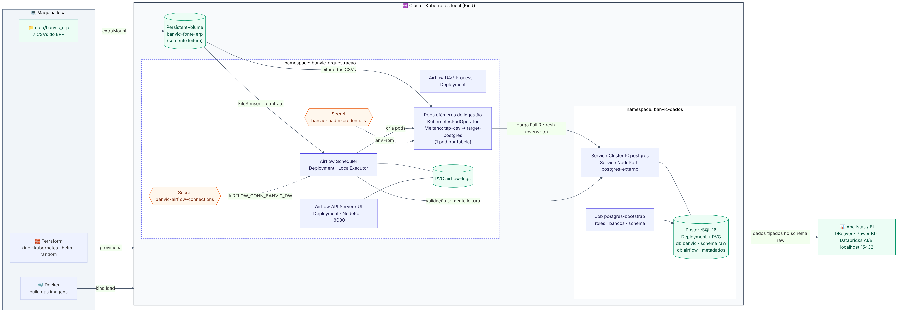
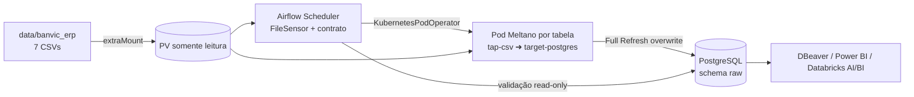

# BanVic Data Platform — POC de Engenharia de Dados

Plataforma local que **centraliza os dados do ERP do Banco Vitória (BanVic)** em um PostgreSQL, com infraestrutura 100% declarada em **Terraform**, execução em **Kubernetes (Kind)**, ingestão com **Meltano** e orquestração com **Apache Airflow**.

> Desafio da Certificação Data Engineer by Indicium — autor: **Henrique Rios**
>
> Rastreabilidade de cada critério da avaliação: [`docs/matriz_avaliacao.md`](docs/matriz_avaliacao.md)

---

## Sumário

1. [Contexto e objetivo](#1-contexto-e-objetivo)
2. [Arquitetura](#2-arquitetura)
3. [Escolha das ferramentas](#3-escolha-das-ferramentas)
4. [Estrutura do repositório](#4-estrutura-do-repositório)
5. [Como executar (passo a passo)](#5-como-executar-passo-a-passo)
6. [Estratégia de ingestão](#6-estratégia-de-ingestão)
7. [Orquestração (DAG)](#7-orquestração-dag)
8. [Monitoramento, falhas e idempotência](#8-monitoramento-falhas-e-idempotência)
9. [Segurança e gerenciamento de segredos](#9-segurança-e-gerenciamento-de-segredos)
10. [Infraestrutura como código](#10-infraestrutura-como-código)
11. [O que a primeira execução revelou](#11-o-que-a-primeira-execução-revelou)
12. [Desenvolvimento local e testes](#12-desenvolvimento-local-e-testes)
13. [Solução de problemas](#13-solução-de-problemas)
14. [Valor para o negócio](#14-valor-para-o-negócio)
15. [Roadmap sugerido para o BanVic](#15-roadmap-sugerido-para-o-banvic)

---

## 1. Contexto e objetivo

Hoje as análises do BanVic são feitas em planilhas e apresentações, a partir de cópias manuais dos sistemas. A CEO quer adotar decisões orientadas a dados, começando por um **dashboard da área comercial** (aumentar transações por cliente e reduzir churn) e por uma **análise quantitativa das alavancas de negócio**.

Esta POC entrega a fundação para isso: um **pipeline ELT orquestrado e reprodutível** que replica, de forma íntegra e tipada, as **7 tabelas do ERP** (`banvic_data.zip`) para um ambiente centralizado de fácil acesso — o schema `raw` de um PostgreSQL.

| Tabela | Registros | Chave |
|---|---:|---|
| `agencias` | 10 | `cod_agencia` |
| `clientes` | 998 | `cod_cliente` |
| `colaboradores` | 100 | `cod_colaborador` |
| `colaborador_agencia` | 100 | `cod_colaborador` |
| `contas` | 999 | `num_conta` |
| `propostas_credito` | 2.000 | `cod_proposta` |
| `transacoes` | 71.999 | `cod_transacao` |

Modelo conceitual (relacionamentos e tipos como chegam no PostgreSQL): [`docs/modelo_conceitual.png`](docs/modelo_conceitual.png).

---

## 2. Arquitetura



<details>
<summary>Versão Mermaid do diagrama (renderizada pelo GitHub)</summary>

Fonte em [`docs/arquitetura.mmd`](docs/arquitetura.mmd).


</details>

**Fluxo dos dados**

```text
CSV (pasta do host) ──extraMount──► PersistentVolume (RO)
                                      │
             ┌────────────────────────┴──────────────────────────┐
             ▼                                                    ▼
  Airflow Scheduler (namespace banvic-orquestracao)     Pod efêmero do Meltano (1 por tabela)
   ├─ FileSensor: arquivo chegou?                        tap-banvic-<tabela> ➜ target-postgres
   ├─ validar_contrato: cabeçalho/estrutura                          │
   ├─ carregar_raw ─── cria o pod ───────────────────────────────────┘
   └─ validar_carga: volume, chave e TIPOS no destino               ▼
                                         PostgreSQL (namespace banvic-dados) ── schema raw
                                                                     │
                                                       Analistas / BI (localhost:15432)
```

**Componentes no Kubernetes**

| Namespace | Recurso | Tipo | Função |
|---|---|---|---|
| `banvic-dados` | `postgres` | Deployment + PVC | Data Warehouse simulado (db `banvic`, schema `raw`) e metadados do Airflow (db `airflow`) |
| `banvic-dados` | `postgres` | Service ClusterIP | Endereço estável interno: `postgres.banvic-dados.svc.cluster.local:5432` |
| `banvic-dados` | `postgres-externo` | Service NodePort | Acesso do seu computador: `localhost:15432` |
| `banvic-dados` | `postgres-bootstrap-<hash>` | Job | Cria roles, bancos e schema (SQL idempotente) |
| `banvic-orquestracao` | `airflow-api-server` | Deployment + Service NodePort | UI/API do Airflow em `http://localhost:8080` |
| `banvic-orquestracao` | `airflow-scheduler` | Deployment | Agenda e executa as tasks (LocalExecutor) |
| `banvic-orquestracao` | `airflow-dag-processor` | Deployment | Faz o parse das DAGs |
| `banvic-orquestracao` | `meltano-<tabela>-*` | Pod efêmero | Ingestão isolada, criada pelo KubernetesPodOperator |
| `banvic-orquestracao` | `airflow-logs` | PVC | Logs das tasks persistidos (com retenção) |
| cluster | `banvic-fonte-erp` | PV + PVC (RO) | Pasta `data/banvic_erp` do host, sem embutir dados em imagens |

---

## 3. Escolha das ferramentas

| Necessidade | Escolha | Por quê | Alternativa considerada |
|---|---|---|---|
| IaC | **Terraform** (providers `kind`, `kubernetes`, `helm`, `random`) | Um único `terraform apply` cria cluster, namespaces, secrets, volumes, banco, imagens e Airflow, de forma declarativa e idempotente. O state permite reexecutar sem duplicar nada. | Scripts imperativos (PowerShell/Bash): mais frágeis e sem controle de estado. |
| Kubernetes local | **Kind** | Cluster leve dentro do Docker, sobe em segundos, permite fixar a versão do Kubernetes (`node_image`) e montar a pasta de dados do host (`extraMounts`). | Minikube: mais pesado no Windows e precisa de driver de VM. |
| Destino | **PostgreSQL 16** | O consumo previsto é analítico/BI (SQL, Power BI, DBeaver). Postgres preserva **tipos** e permite controle de acesso por **roles**. Também serve de backend de metadados do Airflow, economizando recursos locais. | MinIO: ótimo para data lake de arquivos, mas exigiria uma camada de consulta (Trino/DuckDB) para os analistas. |
| Ingestão | **Meltano** (`tap-csv` + `target-postgres`, padrão Singer) | Conectores prontos e testados, configuração declarativa em YAML, `select` de streams/colunas, *stream maps* para tipagem e herança de plugins (um extractor por tabela). | Embulk: também atenderia, mas exige JVM e tem ecossistema menos ativo. |
| Orquestração | **Apache Airflow 3.2** via **Helm chart oficial** | Padrão de mercado; TaskFlow API, sensores, retries e UI. O chart oficial garante Deployments/Services corretos e upgrades simples. | Dagster/Prefect: fora do escopo pedido. |
| Execução da carga | **KubernetesPodOperator** | Cada tabela roda em um **pod isolado** com a imagem do Meltano: o Airflow não disputa memória com a ingestão e a credencial de escrita existe **apenas** no pod de carga. | Rodar o Meltano dentro do container do Airflow (acoplamento e credenciais expostas a todos os componentes). |
| Containers | **Docker** (2 imagens próprias) | `banvic/airflow` (DAGs embarcadas) e `banvic/meltano` (plugins instalados no build). Tag = hash do conteúdo. | — |

**Versões fixadas**

| Componente | Versão |
|---|---|
| Kubernetes (Kind node) | `kindest/node:v1.35.0` — imagem padrão do Kind v0.31 (mesma versão embarcada no provider), fixada por digest |
| Apache Airflow / Helm chart | `3.2.2` / `1.22.0` — chart mais recente, usando a `appVersion` oficial dele |
| Meltano | `4.4.1` |
| tap-csv (MeltanoLabs) | `v1.3.2` |
| target-postgres (MeltanoLabs) | `0.8.0` |
| PostgreSQL | `17-alpine` |
| Providers Terraform | kind `~> 0.11`, kubernetes `~> 3.0`, helm `~> 3.0`, random `~> 3.7` |

---

## 4. Estrutura do repositório

```text
banvic-data-platform/
├── dags/
│   ├── banvic_erp_ingestao_raw.py      # DAG principal
│   ├── banvic/                          # módulos auxiliares (ignorados pelo parser)
│   │   ├── contrato.py                  # contrato das 7 tabelas (colunas, chaves, tipos)
│   │   ├── validacoes.py                # regras de validação de origem e destino
│   │   └── callbacks.py                 # callbacks de falha/retry
│   └── .airflowignore
├── meltano/
│   ├── meltano.yml                      # extractors, loader, tipagem e select
│   └── .env.example                     # variáveis para execução local
├── docker/
│   ├── airflow/Dockerfile               # imagem do Airflow + DAGs
│   └── meltano/Dockerfile               # imagem de ingestão
├── terraform/
│   ├── versions.tf  providers.tf  variables.tf  outputs.tf
│   ├── main.tf                          # cluster Kind + namespaces
│   ├── secrets.tf                       # senhas geradas + Secrets Kubernetes
│   ├── storage.tf                       # PV/PVCs (origem, logs, banco)
│   ├── postgres.tf                      # Deployment, Services e Job de bootstrap
│   ├── images.tf                        # build + kind load das imagens
│   ├── airflow.tf                       # Helm release + usuário admin
│   ├── templates/airflow-values.yaml.tftpl
│   ├── sql/bootstrap_postgres.sql
│   └── terraform.tfvars.example
├── data/banvic_erp/                     # 7 CSVs extraídos do banvic_data.zip
├── scripts/                             # atalhos .ps1 (Windows) e .sh (Linux/macOS)
├── tests/                               # testes de validação e da DAG (pytest)
├── docs/                                # diagramas (.png + .mmd) e matriz_avaliacao.md
├── .gitignore  .dockerignore
└── README.md
```

---

## 5. Como executar (passo a passo)

### 5.1 Pré-requisitos

| Ferramenta | Versão mínima | Windows (winget) |
|---|---|---|
| Docker Desktop | 4.x (rodando) | `winget install Docker.DockerDesktop` |
| Terraform | 1.6 | `winget install Hashicorp.Terraform` |
| Kind | 0.27 | `winget install Kubernetes.kind` |
| kubectl | 1.30 | `winget install Kubernetes.kubectl` |

Recursos recomendados para o Docker: **4 CPUs e 6 GB de RAM**. Acesso à internet é necessário na primeira execução (imagens base, chart do Airflow e plugins do Meltano).

> Não é preciso instalar Helm nem Meltano na máquina: o Helm é usado pelo provider do Terraform e o Meltano roda dentro da imagem.

### 5.2 Dados de origem

Os 7 CSVs do `banvic_data.zip` já estão em `data/banvic_erp/`. Para usar outra cópia, substitua os arquivos nessa pasta (mesmos nomes) ou aponte `source_data_dir` no `terraform.tfvars`.

### 5.3 Subir o ambiente

**Windows (PowerShell)**

```powershell
git clone <url-do-repositorio> banvic-data-platform
cd banvic-data-platform
powershell -ExecutionPolicy Bypass -File .\scripts\subir_ambiente.ps1
```

**Linux/macOS**

```bash
git clone <url-do-repositorio> banvic-data-platform
cd banvic-data-platform
./scripts/subir_ambiente.sh
```

Os scripts apenas validam os pré-requisitos e chamam o Terraform. O equivalente manual é:

```bash
terraform -chdir=terraform init
terraform -chdir=terraform apply
```

O `apply` (≈ 8–12 min na primeira vez) executa, nesta ordem:

1. cria o cluster Kind `banvic` com a pasta `data/banvic_erp` montada e as portas 8080/15432 mapeadas;
2. cria os namespaces `banvic-dados` e `banvic-orquestracao`;
3. gera as senhas e cria os Secrets;
4. cria os volumes (origem somente leitura, logs e dados do banco);
5. sobe o PostgreSQL e roda o Job de bootstrap (roles, bancos e schema `raw`);
6. constrói as imagens `banvic/airflow` e `banvic/meltano` e as carrega no Kind;
7. instala o Airflow pelo Helm chart oficial e cria o usuário admin.

Rodar o `apply` de novo é seguro: sem mudanças, o plano mostra `No changes`.

### 5.4 Acessar o Airflow

- URL: **http://localhost:8080**
- Usuário: `admin`
- Senha: `terraform -chdir=terraform output -raw airflow_admin_password`

### 5.5 Executar o pipeline

A DAG `banvic_erp_ingestao_raw` já nasce ativa e roda todo dia às 06:00 (America/Sao_Paulo). Para executar agora:

- pela UI: abra a DAG e clique em **Trigger**; ou
- pelo script (dispara e acompanha até o fim):

```powershell
.\scripts\executar_dag.ps1        # Windows
./scripts/executar_dag.sh         # Linux/macOS
```

Durante a execução é possível ver os pods de ingestão nascendo e sumindo:

```bash
kubectl --context kind-banvic get pods -n banvic-orquestracao -w
```

### 5.6 Verificar os dados no destino

```powershell
.\scripts\verificar_ambiente.ps1  # pods, services, PVCs, secrets (só nomes), DAG, contagens e tipos
```

Ou conecte o **DBeaver/Power BI** com o usuário somente leitura:

| Campo | Valor |
|---|---|
| Host / Porta | `localhost` / `15432` |
| Banco | `banvic` |
| Usuário | `banvic_reader` |
| Senha | `terraform -chdir=terraform output -raw postgres_reader_password` |

```sql
SELECT COUNT(*) FROM raw.transacoes;   -- 71999
SELECT * FROM raw.contas LIMIT 10;      -- colunas já tipadas (bigint, numeric, timestamp)
```

### 5.7 Desligar

```powershell
.\scripts\destruir_ambiente.ps1   # ou: terraform -chdir=terraform destroy
```

---

## 6. Estratégia de ingestão

### ELT: Extract → Load → (Transform depois)

Os dados são extraídos dos CSVs e carregados **como estão** no schema `raw`, sem regras de negócio. A única conversão feita no caminho é a **tipagem fiel à origem** (texto → inteiro/decimal/data), para que o dado não chegue corrompido nem precise ser reinterpretado por cada analista. Transformações (staging, fatos, dimensões) ficam para uma camada posterior (ex.: dbt).

### Full Refresh idempotente

Para o cenário inicial do BanVic (arquivos de snapshot, sem coluna confiável de alteração), cada execução **replica a totalidade** de cada arquivo:

- `metadata: "*": replication-method: FULL_TABLE` no extractor;
- `load_method: overwrite` no `target-postgres`: a tabela é substituída pelo snapshot atual.

Rodar a DAG 1 ou 10 vezes produz exatamente o mesmo resultado, sem duplicar registros. Isso foi validado comparando **todas as células** da origem com o destino (0 divergências em 76.206 registros).

### Configuração do Meltano (`meltano/meltano.yml`)

| Recurso | Uso no projeto |
|---|---|
| **Plugins declarados no projeto** | `tap-csv` e `target-postgres` são definidos no próprio `meltano.yml` (namespace, executável, capabilities e settings), sem depender do Meltano Hub nem de lock files. O build da imagem instala versões fixadas (`tap-csv v1.3.2`, `target-postgres 0.8.0`). |
| **Extractor (Tap)** `tap-csv` | Declara os 7 arquivos, chaves, encoding, delimitador e `strict: true`. O caminho usa `$BANVIC_SOURCE_DIR`, definido pelo ambiente. |
| **Tipagem** (`stream_maps`) | Converte cada coluna para o tipo da origem: `int()`, `float()` (→ `numeric`), `datetime.date.fromisoformat()` e `datetime.datetime.fromisoformat()`. O tipo é publicado no SCHEMA do Singer e o target cria `bigint`, `numeric`, `date` e `timestamp`. |
| **Seleção** (`select`) | Lista explícita de cada stream e atributo (equivalente a `meltano select tap-csv <stream> <coluna>`). Uma coluna nova na origem não é carregada sem revisão. |
| **Um extractor por tabela** | `tap-banvic-<tabela>` herda tudo do `tap-csv` (`inherit_from`) e usa `select_filter` para executar só a sua stream. Cada tabela vira uma task independente no Airflow. |
| **Loader (Target)** `target-postgres` | Conexão lida das variáveis `TARGET_POSTGRES_*` pelo mapeamento automático do Meltano (`password` declarado como `kind: password`, `sensitive: true`), schema `raw`, `validate_records: true` e `add_record_metadata: true` (colunas `_sdc_*` de linhagem). |

Comandos úteis (dentro de `meltano/`):

```bash
meltano select tap-csv --list --all             # streams e atributos selecionados
meltano run tap-banvic-contas target-postgres   # carga de uma tabela
meltano run tap-csv target-postgres             # carga das 7 tabelas
```

### Mapeamento de tipos

| Origem (CSV) | Exemplo | Destino (PostgreSQL) |
|---|---|---|
| Códigos e contadores | `cod_cliente`, `quantidade_parcelas` | `bigint` |
| Valores monetários e taxas | `saldo_total`, `taxa_juros_mensal` | `numeric` |
| Datas | `data_nascimento`, `data_abertura` (agências) | `date` |
| Data/hora com sufixo `UTC` | `data_transacao`, `data_inclusao` | `timestamp` (valor em UTC) |
| Textos, CPF/CNPJ, CEP | `email`, `cpfcnpj`, `cep` | `text` (preserva zeros e máscaras) |

---

## 7. Orquestração (DAG)

**DAG:** `banvic_erp_ingestao_raw` — [`dags/banvic_erp_ingestao_raw.py`](dags/banvic_erp_ingestao_raw.py)

```text
inicio
  ├─► [agencias]            aguardar_arquivo ► validar_contrato ► carregar_raw ► validar_carga ─┐
  ├─► [clientes]            aguardar_arquivo ► validar_contrato ► carregar_raw ► validar_carga ─┤
  ├─► [colaboradores]       ...                                                                 ├─► verificar_integridade_referencial ► fim
  ├─► [colaborador_agencia] ...                                                                 │
  ├─► [contas]              ...                                                                 │
  ├─► [propostas_credito]   ...                                                                 │
  └─► [transacoes]          aguardar_arquivo ► validar_contrato ► carregar_raw ► validar_carga ─┘
```

| Task | Operador | Responsabilidade (uma operação por task) |
|---|---|---|
| `aguardar_arquivo` | `FileSensor` (modo `reschedule`) | Espera o CSV no volume de origem sem ocupar slot do executor |
| `validar_contrato` | `@task` (TaskFlow) | Confere cabeçalho e estrutura do CSV contra o contrato; retorna `{linhas, sha256}` via XCom (só metadados) |
| `carregar_raw` | `KubernetesPodOperator` | Executa `meltano run tap-banvic-<tabela> target-postgres` em um pod isolado |
| `validar_carga` | `@task` + `PostgresHook` | Compara volume com a origem, unicidade da chave e **tipo de cada coluna** |
| `verificar_integridade_referencial` | `@task` | Conta registros órfãos nos 8 relacionamentos (alerta, não bloqueia) |

**Boas práticas aplicadas**

| Prática | Implementação |
|---|---|
| Parâmetros da DAG | `dag_id` único, `start_date` estático (`2026-01-01`, America/Sao_Paulo), `schedule="0 6 * * *"`, `catchup=False`, `max_active_runs=1`, `dagrun_timeout=1h` |
| `default_args` | `retries=3`, `retry_delay=1min`, `retry_exponential_backoff`, `max_retry_delay=10min`, `execution_timeout=20min`, callbacks de falha e retry |
| Documentação na UI | `description`, `doc_md` (docstring do arquivo), `tags`, `tooltip` nas TaskGroups |
| Dependências | `chain()` entre tasks e TaskGroups; uma TaskGroup por tabela gerada a partir do contrato |
| Sem código pesado no top-level | Leitura de arquivos, consultas e hooks só dentro das tasks; o top-level apenas declara operadores |
| Variables via Jinja | `{{ var.value.banvic_source_dir }}`, `{{ var.value.banvic_ingestion_image }}`, `{{ var.value.banvic_k8s_namespace }}`, lidas só em tempo de execução |
| XCom | Apenas metadados pequenos (contagem, hash, nome da tabela), nunca dados |
| Código modular | Contrato, validações e callbacks em `dags/banvic/`, cobertos por testes unitários |

---

## 8. Monitoramento, falhas e idempotência

- **Retries com backoff exponencial** em todas as tasks (via `default_args`); o sensor usa o próprio `timeout` (15 min).
- **Falhas isoladas por tabela**: se `transacoes` falhar, as outras 6 tabelas seguem e só ela é reprocessada (*Clear* na task).
- **Timeouts**: `execution_timeout` por task e `dagrun_timeout` por execução.
- **Callbacks**: `on_failure_callback` e `on_retry_callback` registram mensagens estruturadas (`FALHA no pipeline BanVic | dag=... | task=...`), ponto único para plugar Slack/e-mail.
- **Validação em duas pontas**: contrato da origem antes da carga e volume/chave/tipos depois da carga. Qualquer divergência falha a task.
- **Idempotência**: carga `overwrite` (Full Refresh), Job de bootstrap SQL com `IF NOT EXISTS`, Terraform declarativo e `max_active_runs=1`.
- **Logs persistentes**: PVC `airflow-logs` + *log groomer* do chart com retenção de 7 dias.
- **Self-healing**: PostgreSQL e componentes do Airflow como Deployments, com probes de readiness/liveness.

---

## 9. Segurança e gerenciamento de segredos

**Nenhuma credencial em texto claro no repositório** — nem na DAG, nem no `meltano.yml`, nem nos manifests.

| Camada | Como os segredos são tratados |
|---|---|
| Terraform | Senhas geradas com `random_password` ou informadas por variáveis com **`sensitive = true`** (ocultas no plan/apply). Outputs sensíveis só aparecem com `terraform output -raw`. |
| Kubernetes | Tudo vira **Secret** nativo, injetado como variável de ambiente apenas no container que precisa. |
| Meltano | O `meltano.yml` não tem nenhum dado de conexão: host, usuário e senha vêm das variáveis `TARGET_POSTGRES_*`. Localmente os valores vêm de `meltano/.env` (no `.gitignore`; há um `.env.example`). |
| Airflow | Connection `banvic_dw` no padrão **`AIRFLOW_CONN_BANVIC_DW`**, vinda de Secret e injetada **só no scheduler**. Os valores de `password` de Connections são mascarados automaticamente nos logs e na UI. |
| Git | `.gitignore` cobre `.env`, `*.tfvars`, `*.tfstate*`, chaves e kubeconfig. |

**Princípio do menor privilégio**

| Identidade | Pode | Recebida por |
|---|---|---|
| `banvic_admin` (superusuário) | Tudo no PostgreSQL | Só o pod do PostgreSQL e o Job de bootstrap |
| `airflow_meta` | Dono apenas do banco `airflow` | Componentes do Airflow (Secret `airflow-metadata`) |
| `banvic_loader` | Criar/substituir tabelas no schema `raw` | **Só os pods do Meltano** (`envFrom` do Secret `banvic-loader-credentials`) |
| `banvic_reader` | `SELECT` no schema `raw` | Scheduler (Connection `banvic_dw`) e analistas |
| ServiceAccount `banvic-ingestao` | Nada no cluster, sem token montado | Pods de ingestão |

Os pods de ingestão também rodam como **não-root** (uid 10001), sem escalonamento de privilégio e com todas as *capabilities* removidas.

> O state do Terraform contém as senhas geradas — por isso fica fora do Git. Em produção, o state iria para um backend remoto criptografado e os Secrets para um cofre (Vault, AWS Secrets Manager, Azure Key Vault).

---

## 10. Infraestrutura como código

Toda a infraestrutura está em `terraform/`, separada por responsabilidade:

| Arquivo | Conteúdo |
|---|---|
| `versions.tf` | Versão do Terraform e dos providers |
| `providers.tf` | Configuração dos providers (credenciais vindas do próprio `kind_cluster`) |
| `variables.tf` | 30 variáveis com descrição e padrão (nomes, portas, versões, tamanhos, senhas `sensitive`) |
| `main.tf` | Locals, cluster Kind e namespaces |
| `secrets.tf`, `storage.tf`, `postgres.tf`, `images.tf`, `airflow.tf` | Recursos por domínio |
| `outputs.tf` | URLs, contexto do kubectl, imagens e senhas (sensíveis) |

**Idempotência**: tudo é declarativo. As imagens recebem como tag o **hash do conteúdo** (DAGs, `meltano.yml`, Dockerfiles): só são reconstruídas quando algo muda, e nesse caso o Helm faz o rollout sozinho. O Job de bootstrap tem o hash do SQL no nome e roda de novo apenas se o script mudar ou se as senhas forem trocadas. O caminho dos dados é calculado a partir da raiz do projeto, sem caminhos pessoais fixos.

---

## 11. O que a primeira execução revelou

Além de carregar os dados, o pipeline produz um diagnóstico a cada execução. Na base fornecida, os resultados foram:

**Validações por tabela (`validar_carga`)** — as 7 tabelas passaram: volume idêntico ao CSV, chave única e todos os tipos conforme o contrato (`dags/banvic/contrato.py`).

**Integridade entre tabelas (`verificar_integridade_referencial`)** — 6 dos 8 relacionamentos estão íntegros. Os 2 alertas apontam para o **mesmo cliente**:

| Relacionamento | Registros órfãos | Detalhe |
|---|---:|---|
| `contas.cod_cliente → clientes` | 1 | conta do cliente `528`, que não existe em `clientes.csv` |
| `propostas_credito.cod_cliente → clientes` | 4 | 4 propostas do mesmo cliente `528`, somando R$ 513.470,87 em financiamento |

Leitura para o negócio: há uma conta ativa e propostas de crédito relevantes vinculadas a um cliente ausente do cadastro — algo a reportar para a área dona do CRM antes de qualquer análise de crédito por cliente. A camada `raw` mantém esses registros exatamente como vieram (ela é o espelho da origem); o alerta fica registrado no log da DAG e o tratamento cabe à camada de transformação.

---

## 12. Desenvolvimento local e testes

**Testes automatizados** (contrato, validações e integridade da DAG):

```bash
python -m venv .venv && . .venv/bin/activate     # Windows: .venv\Scripts\activate
pip install pytest
pytest -q tests                                   # testes da DAG rodam se o Airflow estiver instalado
```

**Meltano fora do Kubernetes** (com o ambiente no ar, usando a porta 15432):

```bash
cd meltano
cp .env.example .env     # preencha TARGET_POSTGRES_PASSWORD (Secret banvic-loader-credentials)
pip install meltano==4.4.1
meltano install
meltano run tap-banvic-agencias target-postgres
```

---

## 13. Solução de problemas

| Sintoma | Causa provável / solução |
|---|---|
| `kind load docker-image` falha | O `kind` precisa estar no PATH do terminal que roda o Terraform. Reabra o terminal após instalar. |
| Porta 8080 ou 15432 ocupada | Altere `airflow_host_port` / `postgres_host_port` no `terraform.tfvars` (isso recria o cluster). |
| `FileSensor` aguardando para sempre | Confira se os 7 CSVs estão em `data/banvic_erp` e se o Docker Desktop tem permissão de compartilhar a pasta. |
| Pod do Meltano em `ImagePullBackOff` | Rode `terraform apply` de novo para reconstruir e recarregar a imagem no Kind. |
| `helm_release` demora / timeout | Aumente a memória do Docker (≥ 6 GB) e rode o `apply` novamente (é idempotente). |
| Ver logs de um pod de ingestão | Os logs aparecem na task `carregar_raw` da UI (`get_logs=True`). |

---

## 14. Valor para o negócio

A POC resolve o primeiro obstáculo do projeto de dados do BanVic: **dados confiáveis, centralizados e sempre atualizados**, sem depender de cópias manuais.

- **Área comercial (Camila Diniz)**: com `transacoes`, `contas` e `clientes` integrados e tipados, o dashboard pode medir **transações por cliente**, **dias desde a última movimentação** (`data_ultimo_lancamento`) e sinais de **risco de churn** por agência e por gerente, atualizados todo dia às 06:00 sem trabalho manual da equipe.
- **Diretoria (Sofia Oliveira)**: o histórico de `propostas_credito` (taxa, valor, parcelas, carência, status) junto ao comportamento transacional é a base para modelar quais **alavancas** realmente movem o ponteiro (por exemplo, regressão sobre volume transacionado ou aprovação de crédito) e montar o **ranking quantitativo** pedido.
- **Tecnologia (André Tech)**: fim das análises manuais e de seus riscos: pipeline versionado, testado, auditável (colunas `_sdc_*` de linhagem, validações e logs) e reproduzível em qualquer máquina com um comando.
- **Governança**: o acesso de leitura é separado por usuário, o que facilita liberar dados para a área comercial sem expor credenciais de escrita, reduzindo a burocracia de permissões citada no contexto.

---

## 15. Roadmap sugerido para o BanVic

A POC cobre a fase de **ingestão**. A evolução natural, em ordem de valor para o negócio:

| Fase | Entrega | Por que importa |
|---|---|---|
| 1. Modelagem | Camada de transformação com **dbt** sobre o `raw` (staging → marts de clientes, transações e crédito) e testes de dados declarativos | Alimenta o dashboard comercial com métricas prontas (transações por cliente, inatividade, churn) |
| 2. Análise de alavancas | Base analítica por cliente/mês cruzando crédito e comportamento transacional | Permite o ranking quantitativo pedido pela CEO |
| 3. Operação | Alertas reais (Teams/Slack) no `on_failure_callback`, métricas do Airflow e CI com `terraform validate` + `pytest` a cada PR | Confiabilidade sem depender de alguém olhar a UI |
| 4. Produção | Carga incremental (quando a origem tiver coluna de alteração), PostgreSQL gerenciado/StatefulSet, state do Terraform remoto e Secrets em cofre externo | Escala e segurança para sair do ambiente local |
